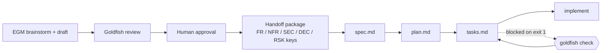

# goldfish-gate

[](https://github.com/PhilopaterSh/goldfish-gate/actions/workflows/ci.yml)
[](LICENSE)

**Machine-checked traceability between an approved design and spec-driven
execution.** The handoff gate for [Elephant-Goldfish Model](https://github.com/google/elephant-goldfish-model)
workflows that continue into [Spec Kit](https://github.github.io/spec-kit/).

## The problem this solves

EGM makes design quality a process: an elephant (deep context) drafts, a
goldfish (fresh context) reviews, a human approves. Spec Kit makes execution
a process: specify, plan, tasks, implement. But the seam between them is
unguarded. Nothing stops the generated `spec.md` from quietly dropping a
security requirement, a `plan.md` from reinterpreting an approved decision,
or a `tasks.md` from forgetting a requirement entirely.

goldfish-gate turns that seam into a mechanical contract:



## Quickstart

```bash
git clone https://github.com/PhilopaterSh/goldfish-gate
cd goldfish-gate
pip install .

# healthy chain: exit 0
goldfish check examples/pass/design.md examples/pass/spec.md examples/pass/plan.md examples/pass/tasks.md

# broken chain: exit 1, every violation named and located
goldfish check examples/fail/design.md examples/fail/spec.md examples/fail/plan.md examples/fail/tasks.md

# validate a handoff package (the chain's first link)
goldfish handoff examples/pass/handoff.md

# scaffold a new feature chain
goldfish init my-feature
```

Zero runtime dependencies. Python 3.10+.

## The ID grammar

The approved design is the single source of traceability keys. Keys are
uppercase `PREFIX-NN` tokens defined in a Traceability Key table:

| Prefix family | Keys | Required destination |
| --- | --- | --- |
| Requirements | `FR-01` `NFR-01` `SEC-01` `DATA-01` `OPS-01` | every key reaches `spec.md` **and** `tasks.md` |
| Decisions | `DEC-01` | every key reaches `plan.md` |
| Risks | `RSK-01` | acknowledged in `plan.md` or `spec.md` |

## What `goldfish check` enforces

| Code | Severity | Meaning |
| --- | --- | --- |
| `no-keys` | FAIL | the design declares no traceability keys at all |
| `missing-in-spec` | FAIL | a design requirement never reaches the spec |
| `missing-in-tasks` | FAIL | a design requirement has no implementing task |
| `missing-in-plan` | FAIL | an approved decision is not reflected in the plan |
| `invented-key` | FAIL | a downstream key the approved design never defined |
| `risk-unacknowledged` | WARN | an accepted risk nobody downstream carries |
| `duplicate-key` | WARN | two Traceability Key rows define the same key |
| `orphan-task` | WARN | a task with no key parent and no `[enabling]` tag |
| `enabling-budget` | WARN | `[enabling]` tasks exceed `--max-enabling` (default 2) |
| `waiver-invalid` | WARN | a waiver comment missing owner/date or unparsable |
| `waiver-expired` | WARN | an expired waiver would have applied; renew or remove |

Exit codes: `0` contract holds, `1` failures found (block CI), `2` usage
error. Reports come as `text`, `markdown` (paste into a PR), or `json`.
Findings suppressed by a valid waiver keep severity `WAIVED`, stay in every
report, and never affect the exit code.

## Handoff validation

The chain's first link is guarded too. `goldfish handoff <file>` verifies a
handoff package before Spec Kit consumes it:

| Code | Meaning |
| --- | --- |
| `handoff-no-approval` | no approval marker on any body line (headings never count) |
| `handoff-missing-section` | one of the eight required sections is absent |
| `handoff-no-keys` | the Traceability Key table has no rows |
| `handoff-risk-unowned` | a risk line in the Risks section carries no owner/gate evidence |

## Waivers

For the rare case where a design amendment is pending but work must continue,
a finding can be waived inline, in any of the four files:

```markdown
<!-- goldfish-waiver: invented-key FR-09 until=2027-01-31 owner=design-owner -->
```

Rules: `until` (YYYY-MM-DD) and `owner` are required; a waiver missing either
warns (`waiver-invalid`) and never silences. An expired waiver never
suppresses, and when it would have applied you get `waiver-expired` asking
you to renew or remove it. Waivers inside fenced code blocks are ignored.
`--no-waivers` turns the mechanism off entirely.

## Use it in CI directly

```yaml
- uses: PhilopaterSh/goldfish-gate@v1
  with:
    design: docs/designs/my-feature.md
    spec: specs/my-feature/spec.md
    plan: specs/my-feature/plan.md
    tasks: specs/my-feature/tasks.md
```

## What goldfish-gate does NOT do

- It does not prove your design is correct. The goldfish review reduces
  anchoring bias; it does not replace human approval.
- It does not verify the implementation. Tests still own that. This gate
  checks that the approved design survived translation, not that the code
  works.
- It is not an official EGM or Spec Kit integration. As of 2026-11-05,
  neither project documents a connector; this is an independent workflow
  adapter over their documented artifact formats.
- It does not parse semantics. Keys are matched textually in markdown. A
  requirement described without its key is invisible to the gate; write the
  keys down.

## The egm-handoff skill

`skills/egm-handoff/SKILL.md` is an agent skill (Claude Code / Codex /
Antigravity compatible) that generates the handoff package from an approved
EGM design and refuses to proceed while blockers or approval are missing.
Copy it into your agent's skills directory alongside `templates/`.

## Dogfooding

This repository is built with its own workflow: the feature chain in
`examples/` doubles as CI fixtures, CI asserts that the healthy chain passes
and the broken chain fails. See `docs/DESIGN.md` for the design document and
the planned self/ evidence chain.

## Related work

Test-suite-derived requirement catalogs (which turn tests into a machine
checked catalog and gate code drift) cover the downstream side.
goldfish-gate covers the upstream side: the design-to-spec translation,
before implementation exists. The two compose.

## Roadmap

- [ ] Drift report: design keys vs current code surface
- [ ] Version compatibility matrix (tested Spec Kit / agent versions)
- [ ] `self/` evidence chain: features developed with the repo's own workflow

## Attribution and license

Built on the ideas of Google's Elephant-Goldfish Model and GitHub's Spec
Kit. This project is independent and unaffiliated with either. MIT license,
see [LICENSE](LICENSE).
